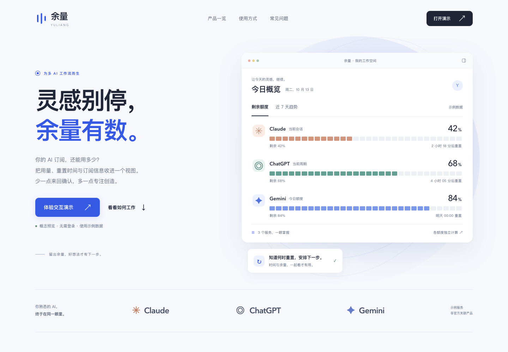
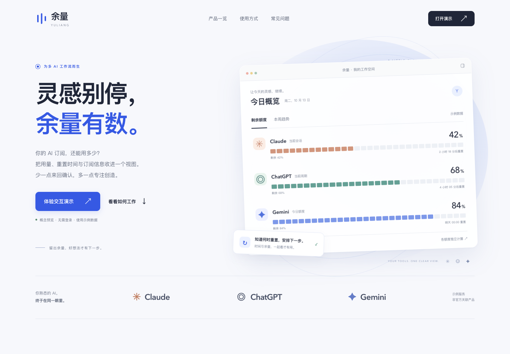

# 余量 · AI 订阅用量概念官网

[网站精修 Skill](../../../website-refine/SKILL.md) 的可运行示例：为同时使用多个 AI 服务的人，展示集中查看剩余额度、重置时间与订阅记录的产品概念。

采用冷白与靛蓝，通过分段额度条、刻度和产品界面形成统一视觉。所有数据都是本地示例，无真实账号、账单或服务接入，与所展示服务无官方关联。



## 打开与体验

克隆或下载仓库后，直接用浏览器打开 [site/index.html](site/index.html)。页面无外部运行依赖，无需登录或构建。

也可以在本示例目录运行以下命令，再打开终端显示的地址（默认 `http://127.0.0.1:4173`）：

```sh
npm run dev
```

端口被占用时，通过 `YULIANG_PORT` 指定其他端口，例如：

```sh
YULIANG_PORT=4174 npm run dev
```

可体验的操作：

- 切换剩余额度与近 7 天趋势。
- 切换额度、重置时间和订阅记录三个情境。
- 打开服务详情，拖动滑块模拟余量变化；概览与仪表盘同步更新。
- 使用键盘切换标签、操作滑块，按 Escape 关闭弹窗并返回原焦点。

刷新页面恢复初始数据。[查看约 14 秒交互录屏](previews/walkthrough.mp4)。

## 精修关注点

本例先构建可运行首版，再使用 `website-refine` 检查和精修。以下两张首屏截图均为 1440 × 1000 像素。

| 首版 | 精修后 |
| --- | --- |
|  |  |

| 观察 | 最终调整 |
| --- | --- |
| 倾斜的数据面板与浅色辅助信息影响阅读 | 端正面板，提高文字对比，强化余量与重置时间 |
| 提示卡遮挡产品面板底部，仪表盘文字与弧线拥挤 | 将提示卡移到面板下方，重新安排仪表盘标签 |
| 装饰轨道造成窄屏横向溢出 | 单独约束装饰区域，保留内容的完整布局 |
| 交互需要在不同屏幕与视图之间保持一致 | 标签按布局方向响应键盘，额度变化同步到各视图 |

[查看官网整页](previews/full-page.png) · [查看手机布局](previews/mobile.png)

## 本地验证

需要 Node.js 20 或更新版本。首次安装检查依赖和 Chromium：

```sh
npm ci
npx playwright install chromium
npm test
```

如果已安装 Google Chrome，可在 `npm ci` 后直接使用该浏览器：

```sh
PLAYWRIGHT_CHANNEL=chrome npm test
```

检查脚本会自动启动本示例的独立本地服务，并在结束后关闭服务和浏览器；无需先执行 `npm run dev`。截图和检查结果输出到已忽略的 `.artifacts/`。

覆盖 320、390、768、1024、1440 像素宽度，以及趋势、情境切换、详情弹窗、FAQ、键盘、滑块边界、跨视图数据同步、焦点返回和减少动态效果。自动可访问性检查使用 axe 的 WCAG 2 A/AA 与 2.1 AA 规则。

初次示例验收在 Chrome 中完成。上述检查不代表其他浏览器、真实设备或完整无障碍认证；本例也不承诺真实服务接入能力或获奖资格。

## 文件与参考

- `site/`：可运行网页源码。
- `previews/`：首版与最终截图、演示录屏。
- `server.cjs`：仅绑定本地地址的预览服务。
- `verify.cjs`：自动浏览器检查。

参考 [Superlist](https://www.superlist.com/) 的清楚主张与产品展示，以及 [Linear](https://linear.app/) 的导航层级与留白。转化为当前命题中的额度可视化与中文内容，保留独立的品牌、配色和布局。相关参考为创作时的观察，网站后续可能变化。
